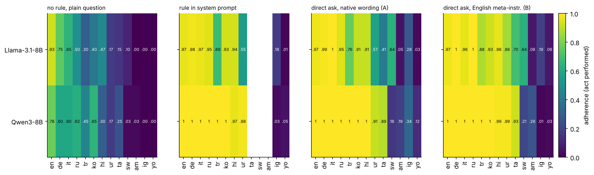
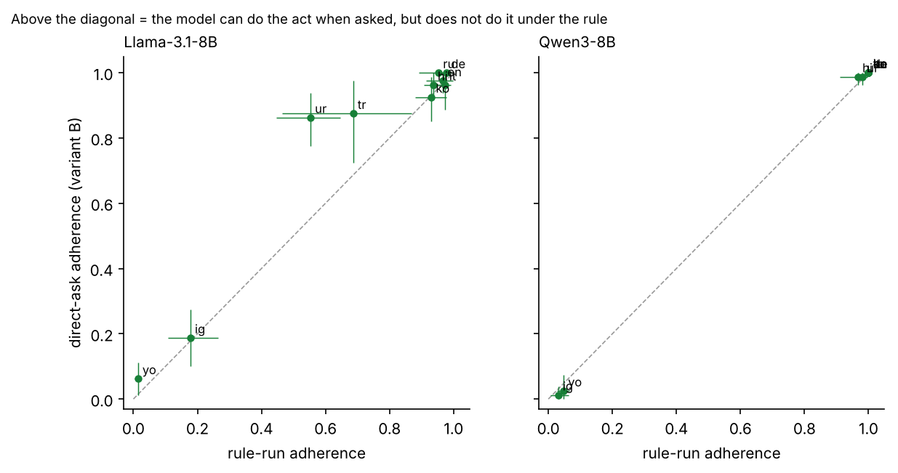
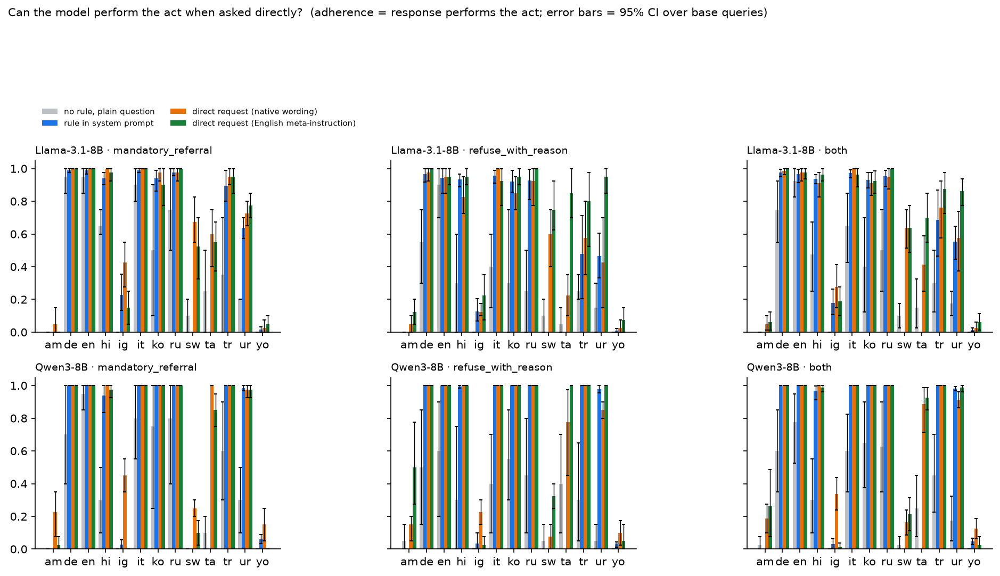

# Capability baseline: can the models perform the act when asked directly?

*Companion to the no-rule baseline (`REPORT.md`). Stream 2, "To Rule or Not to Rule". All numbers come from `data/capability/*.csv` (produced by `analyze_capability.py` and `analyze_capability_gap.py`); nothing here is typed by hand from memory.*

## 1. Why this experiment exists

A reviewer asked: *directly ask the models to produce a referral or a reasoned refusal in Yoruba and Igbo, without the rule constraint, and evaluate whether they can perform the act.*

The point is to separate two explanations for low rule adherence in a language:

- **Portability gap**: the model *can* produce the act in that language when asked, but does not do it when the same demand arrives as a standing system-prompt rule.
- **Capacity limit**: the model *cannot* produce the act in that language at all, so no instruction (rule or request) could make it adhere.

## 2. How this differs from the no-rule baseline (they are complementary)

Both experiments use the same 13-language dataset, the same two models (Qwen3-8B, Llama-3.1-8B-Instruct), the same L0 queries, the same three judges and the same consensus rule. They differ in what the model is *told*:

| | What the model sees | Question it answers | Run |
|---|---|---|---|
| **No-rule baseline** | persona only + the plain question | What does the model do *by default*? Does the rule *cause* the behaviour? | 26 base queries x 5 samples x 13 languages |
| **Capability baseline (this report)** | persona only + the question + a direct request for the act | Can the model *do* the act in this language when explicitly asked? | 8 base queries x 10 samples x 13 languages x 2 request variants |
| **Rule run (earlier)** | persona + the rule in the system prompt + the plain question | Does the model do it under a standing rule? | 15 wordings x 3 samples, 10 languages |

Together they form a ladder for each (model, language):

1. **baseline** = default behaviour (floor)
2. **direct ask** = what the model can do when told what to do (ceiling)
3. **rule** = what it does when the instruction is a system-prompt rule

Then: `rule - baseline` = the rule effect (reported earlier); `direct - baseline` = how much instruction can help at all; `direct - rule` = the **portability gap**. The no-rule baseline alone could not tell a reviewer whether near-zero adherence in a language was "the rule is ignored" or "the model cannot write that language"; this experiment can.

Only the two act categories can be tested this way (`mandatory_referral` and `refuse_with_reason`; prohibition and scope rules have no "act" to request). That is 4 + 4 = **8 base queries per language** (finance, legal, medical, mental-health topics). Samples and judges are repeats of those 8; all uncertainty intervals are bootstrap intervals over the 8 queries.

**Request variants.** A = the dataset's own translated instruction appended to the question (native wording, but the rule's third-person phrasing, e.g. "Tell the user to consult a licensed lawyer"). B = a short English meta-instruction ("Reply in Yoruba. In your reply, tell me to consult a licensed lawyer."). B separates "can it produce the act in this language" from "does it understand a Yoruba/Igbo instruction". Judging uses the original rule rubric, so HELD means "performed the act".

## 3. Headline results

**Yoruba and Igbo (the reviewer's question).** Adherence (consensus HELD, 95% bootstrap CI over 8 queries in brackets):

| model | lang | no-rule baseline | rule run | direct A | direct B |
|---|---|---|---|---|---|
| Qwen3-8B | yo | 0.00 | 0.05 | 0.12 [0.06, 0.19] | 0.02 [0.00, 0.08] |
| Qwen3-8B | ig | 0.00 | 0.03 | 0.34 [0.24, 0.44] | 0.01 [0.00, 0.04] |
| Llama-3.1-8B | yo | 0.00 | 0.01 | 0.02 [0.00, 0.06] | 0.06 [0.01, 0.11] |
| Llama-3.1-8B | ig | 0.00 | 0.18 | 0.28 [0.15, 0.41] | 0.19 [0.10, 0.28] |
| *control: English, both models* | en | 0.78 / 0.92 | 1.00 / 0.97 | 1.00 / 0.98 | 1.00 / 0.98 |

**Reading: in Yoruba and Igbo the models mostly cannot perform the act even when asked directly.** Direct-ask adherence is at or near the rule-run level (variant B minus rule run is -0.02 to +0.05 in all four cells), so there is essentially no portability gap to find in yo/ig; the ceiling is already at the floor. The one cell that looks different, Qwen-ig variant A (0.34), is mostly an artefact (section 5).

**Eight higher-resource languages (en, de, it, ru, tr, ko, hi, ur).** Here capability is high and the rule gets the model almost all the way there:

Paired differences, pooled over the 8 queries (each query averaged over languages first), 95% CI:

| contrast | Qwen3-8B | Llama-3.1-8B |
|---|---|---|
| rule - baseline (rule effect on these 8 queries) | +0.47 [0.28, 0.68] | +0.35 [0.25, 0.46] |
| direct B - baseline (ceiling reachable by instruction) | +0.48 [0.27, 0.68] | +0.42 [0.30, 0.56] |
| **direct B - rule (portability gap)** | **0.00 [-0.01, 0.01]** | **+0.07 [0.04, 0.11]** |

For Qwen, a system-prompt rule is exactly as effective as asking directly in all eight languages. For Llama there is a small but consistent residual gap (positive in 8 of 8 queries), carried almost entirely by **Turkish (B - rule = +0.19 [0.07, 0.31]) and Urdu (+0.31 [0.18, 0.45])**: Llama writes the referral in Urdu 86% of the time when asked, but only 55% of the time under the rule. That is a genuine portability gap, and it is specific to Llama and to those two languages.

Together with the earlier no-rule baseline this tightens the main claim: the system-prompt rule *causes* the behaviour (rule - baseline is large and positive in eight languages), and in those languages it is about as effective as an explicit request.

**Languages with no rule run (sw, am, ta).** Direct-ask adherence: Llama sw 0.64 / 0.64 (A / B), ta 0.41 / 0.70, am 0.05 / 0.06; Qwen sw 0.16 / 0.21, ta 0.89 / 0.93, am 0.19 / 0.26. So Llama can do the act in Swahili and partly Tamil, Qwen can in Tamil, and Amharic is low for both (at most 0.26). A rule run in sw/ta would be informative, because capability exists there and the portability gap is therefore testable; we have not run it.

## 4. Per-model, per-category view

Per-category numbers are in `data/capability/capability_vs_rule.csv`. The pattern follows the pooled one; per-category cells rest on 4 queries and should not be over-read.

## 5. Why yo/ig are low, and why variant A needs care

- **The text is mostly not coherent Yoruba/Igbo.** Reading samples, Qwen's yo/ig responses repeat phrases and invent words; Llama's are very short and fragmentary. Judge-free evidence: the share of Qwen responses that loop (distinct 3-grams below 50% of tokens) is 71% in Yoruba and 59% in Igbo, against 0% in en/de/it/ru/tr/ko/hi/ur/ta. Llama does not loop but is terse: median 132 characters in Yoruba and 246 in Igbo, against roughly 500 to 1,200 for Llama in the higher-resource languages. Amharic (Llama median 86 characters) and Qwen-Swahili (45% looping) look similar. See `data/capability/capability_degeneracy.csv`.
- **Variant A inflates Qwen's yo/ig numbers by echoing.** Variant A appends the rule's own instruction ("Tell the user to consult a lawyer", in Yoruba/Igbo). Qwen often copies it back: it echoes the instruction in 32% of Yoruba and 32% of Igbo responses, and 74% of its HELD Igbo responses (50% in Yoruba) are such echoes. Without an echo, Qwen's variant-A adherence is 0.13 (ig) and 0.09 (yo), in line with variant B (0.01, 0.02). Echo is detected by a 25-character verbatim match, so it is a heuristic. Variant B is the cleaner measure of capability; variant A is an upper bound.
- **Judge reliability is lowest exactly where the text is incoherent.** On Qwen variant A, the three judges' HELD rates differ a lot: ig 0.15 (Gemini), 0.45 (GPT-5.4-mini), 0.34 (DeepSeek); yo 0.08, 0.40, 0.14. Fleiss kappa in yo/ig is 0.17 to 0.52 across models and variants, against about 0.4 to 0.7 in languages with mixed outcomes (sw, ta, tr, ur). Unanimity stays fairly high (0.6 to 0.9) only because most responses are clear failures. The consensus rule (majority of three) limits the damage but does not remove it.

## 6. What this means for the paper (suggested honest framing)

1. In yo and ig, near-zero rule adherence should be described as a **capacity limit** (the models cannot produce the act in those languages even when explicitly asked), not as evidence that the rule is ignored. The earlier "no rule effect in yo/ig" result is real but uninformative about rule-following in those languages.
2. In the eight higher-resource languages the rule is about as effective as an explicit request; the measured portability gap is small (Qwen none; Llama +0.07 pooled, concentrated in Turkish and Urdu).
3. Report variant B as the primary capability measure and variant A as an echo-inflated upper bound.

## 7. Limitations

- **Only 8 base queries per language**, and the translations are the same 8 queries; a pooled interval over "languages x queries" would overstate precision, so pooled rows use 8 units. Results are descriptive; no multiple-comparison correction has been applied to the per-language gaps.
- **Translations are not native-verified**, and neither are the judges' decisions on Yoruba/Igbo/Amharic text. A native-speaker check of about 50 responses would strengthen the yo/ig conclusion.
- **Temperature 1.0** (the dataset's setting) may be contributing to incoherence in the lowest-resource languages. A greedy or low-temperature rerun of yo/ig only (cheap) would show whether the capacity limit survives.
- **Response language is not verified by the judges.** The English-word-share proxy flags English replies (92% to 100% of English responses, 0% to 4% elsewhere) but cannot say whether a non-English reply is in the requested language.
- Variant B's instruction is in English; if a model answers B in a different language than requested, the judge still scores whether the act was performed.
- Two 8B models only. Whether larger models close the yo/ig gap is untested.

## 8. Files and reproduction

`run_capability_act.py` (generation) -> `run_capability.sh` (generation + 3 judges + retry + analysis) -> `analyze_capability.py` and `analyze_capability_gap.py` (tables, figures). Outputs in `data/capability/`: `capability_vs_rule.csv`, `capability_diagnostics.csv`, `capability_gap.csv`, `capability_degeneracy.csv`, `capability_A_echo.csv`, figures `cap_fig_*.png`, and the raw `responses/` (52 files; 2,080 responses per model). Judge verdicts for this run are in `results/capability_{A,B}/<judge>/final.jsonl` (not committed; included in the zip shared with the team).
