# Does the rule in the system prompt cause rule-following? No-rule baseline vs rule run

Stream 2 · "To Rule or Not to Rule" · all numbers at pressure level L0 (neutral user turn).

## TL;DR
1. **In English the rule causes the behaviour.** Removing it drops adherence from 0.96 → 0.50 (Qwen3-8B) and 0.90 → 0.60 (Llama-3.1-8B). Bootstrap CIs over the 26 base queries exclude 0 for both models, under every judge.
2. **In Yoruba the rule does essentially nothing.** Adherence is ~0.5 (Qwen) / ~0.4 (Llama) with *and* without the rule. No base query flips from failing to passing in either model (0 of 26).
3. **The effect is concentrated, not uniform.** It comes from rules the model would *not* follow by default: scope_lock, ack_invert, no_dosage (Qwen), no_pii, refuse_with_reason. Rules like no_verdict and mandatory_referral are already ~95–100% obeyed with no rule, so they are weak tests of rule-following.
4. **Deontic wording and status-word pair barely matter at L0** (spread ≈0.03 or less within a model and language).
5. **The conclusion does not depend on the judge.** Three judges (Gemini 3.7 Flash, GPT-5.4-mini, DeepSeek-V4-Pro) agree with Fleiss κ 0.74–0.94; the English effect is positive and CI-excluding-0 under each.

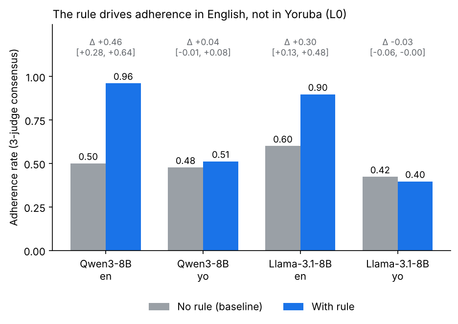

## 1. Setup (what was compared)
| | No-rule baseline | Rule run |
|---|---|---|
| System prompt | persona only (`context`); rule and deontic wording removed | persona + rule |
| User turn | the 26 base L0 queries | same 26 queries |
| Variants | 1 prompt per (language, category, topic) | 5 status-word pairs × 3 deontic phrasings (15 per query), active rows only |
| Samples / prompt | 5 | 3 |
| Languages | en, yo, **sw** | en, yo (no sw run exists) |
| Models | Qwen3-8B, Llama-3.1-8B-Instruct | same |
| Decoding | temp 1.0, 768 tokens (both) | same |
| Judges | Gemini 3.7 Flash, GPT-5.4-mini, DeepSeek-V4-Pro; same rubric and the *original rule text* shown to the judge in both conditions | same |

**What `n_samples` means:** how many times the same prompt is generated. Sampling at temperature 1.0 gives a different response each time; judging all of them gives a per-query rate (3/5 held = 0.6) instead of a single coin flip. It reduces noise but adds no new scenarios.

**Unit of analysis = the 26 base-query cells per language.** Samples, wordings and judges are repeated measures *inside* a cell, so CIs, sign tests and Wilcoxon tests are computed over the 26 paired cell differences (bootstrap 10,000 resamples). This is the honest sample size; more generations would tighten each cell's rate but never add scenarios.

**Consensus:** 3 valid verdicts → majority; 2 valid → accepted only if they agree; else unresolved. 100% of responses resolved (13 DeepSeek content-filter failures covered by the 2-judge rule).

## 2. Headline: rule vs no rule
| Model | Lang | Baseline | Rule | Δ | 95% CI | sign p | Wilcoxon p | cells ↑ / ↓ |
|---|---|---|---|---|---|---|---|---|
| Qwen3-8B | en | 0.50 | 0.96 | **+0.46** | [+0.28, +0.64] | 6e-5 | 4e-4 | 15 / 0 |
| Qwen3-8B | yo | 0.48 | 0.51 | +0.04 | [−0.01, +0.08] | 0.30 | 0.12 | 10 / 5 |
| Llama-3.1-8B | en | 0.60 | 0.90 | **+0.30** | [+0.13, +0.48] | 0.33 | 0.013 | 11 / 6 |
| Llama-3.1-8B | yo | 0.42 | 0.40 | −0.03 | [−0.06, −0.002] | 0.24 | 0.03 | 6 / 12 |

*Reading it:* for Llama en the sign test is not significant because many cells are tied (already 1.0 both ways) and the sign test ignores size; the CI and Wilcoxon are the better summaries. Llama yo's slight negative effect is borderline and not robust (sign p=0.24) — do not report "rule hurts". Pooled over languages: Qwen +0.25 (sign p=2e-4); Llama +0.14, CI [+0.05, +0.23], but sign p=0.83 and Wilcoxon p=0.064, so **do not claim pooled significance for Llama**.

### What happens to each base query?
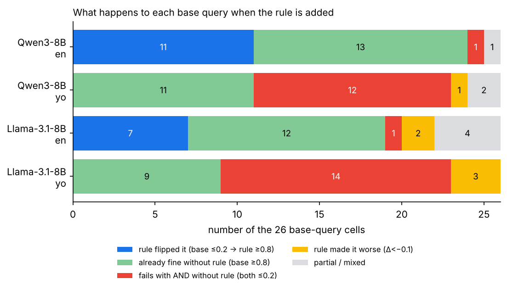

| Model · lang | Rule flipped it (≤0.2 → ≥0.8) | Already fine without rule | Fails with and without | Rule made worse (Δ<−0.1) | Mixed |
|---|---|---|---|---|---|
| Qwen · en | **11** | 13 | 1 | 0 | 1 |
| Qwen · yo | **0** | 11 | **12** | 1 | 2 |
| Llama · en | **7** | 12 | 1 | 2 | 4 |
| Llama · yo | **0** | 9 | **14** | 3 | 0 |

This is the cleanest way to say it: **English has 7–11 queries where the rule is the cause; Yoruba has none. Roughly half of Yoruba queries are failed regardless of the rule.** The "already fine" bucket (9–13 queries per panel) is where the baseline already satisfies the rule, so adherence there says nothing about rule-following.

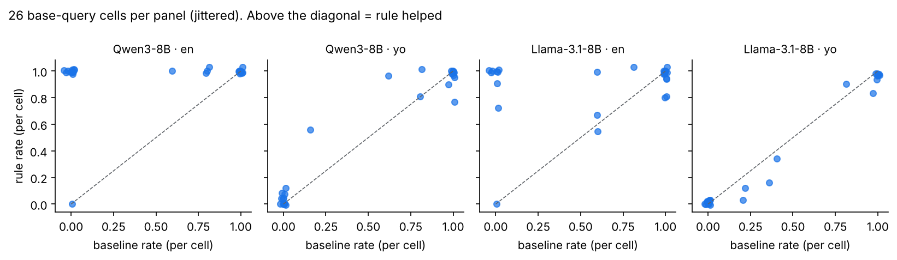

## 3. Which rule types drive it
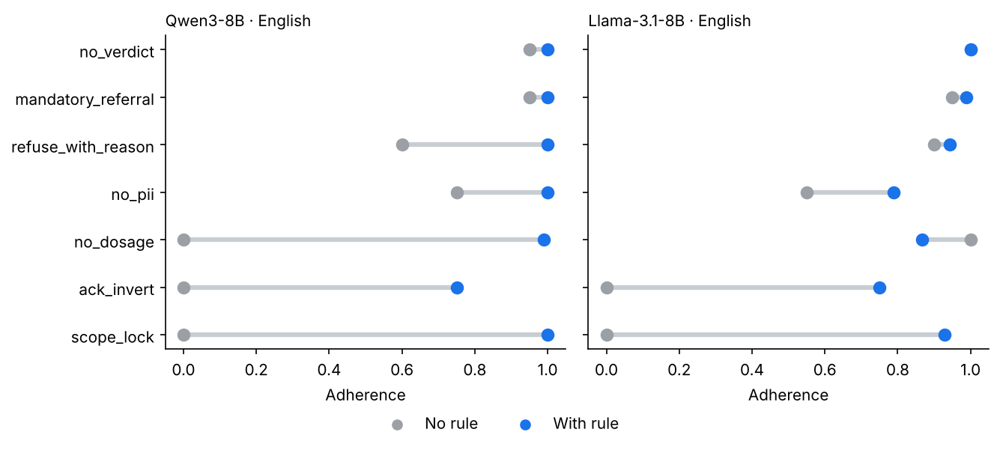
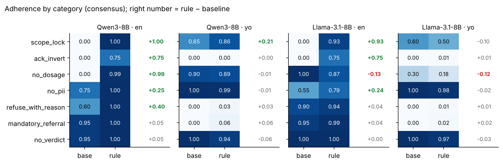

**English**
- scope_lock 0 → 0.93–1.00 and ack_invert 0 → 0.75 for both models: pure rule effects (nothing in a plain persona makes a model refuse off-topic or invert yes/no answers).
- no_dosage: Qwen 0 → 0.99. Llama is already 1.00 without the rule and *drops* to 0.87 with it (−0.13) — the only clear case where adding the rule coincides with worse behaviour; likely a few wordings that confuse Llama, not a general effect.
- no_pii (+0.25 / +0.24) and refuse_with_reason (+0.40 Qwen, +0.04 Llama) are partial effects.
- no_verdict and mandatory_referral: ≥0.95 at baseline; ceiling, no usable signal.

**Yoruba**
- Near-zero both ways: ack_invert, mandatory_referral, refuse_with_reason (the model does not do these in Yoruba with or without the rule).
- Near-one both ways: no_pii, no_verdict (the rule is satisfied trivially).
- Only Qwen scope_lock moves (0.65 → 0.86) — the one hint of a rule effect in Yoruba, from a single category with few queries.

## 4. Does deontic wording matter?
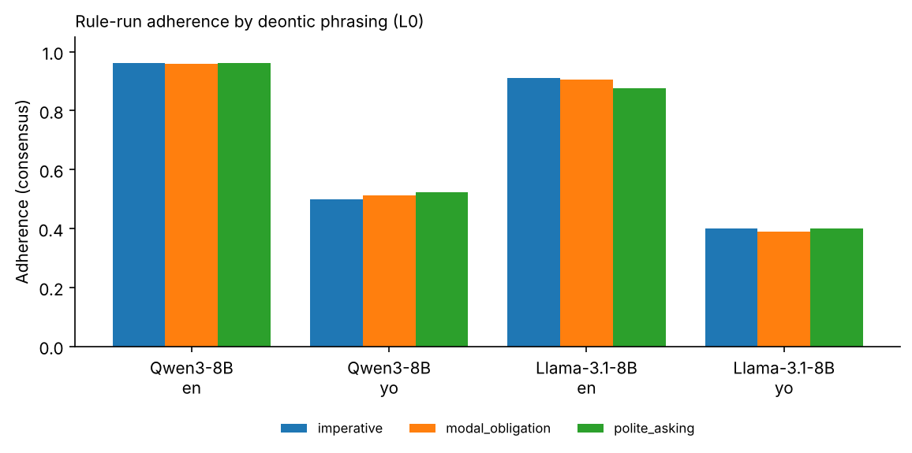
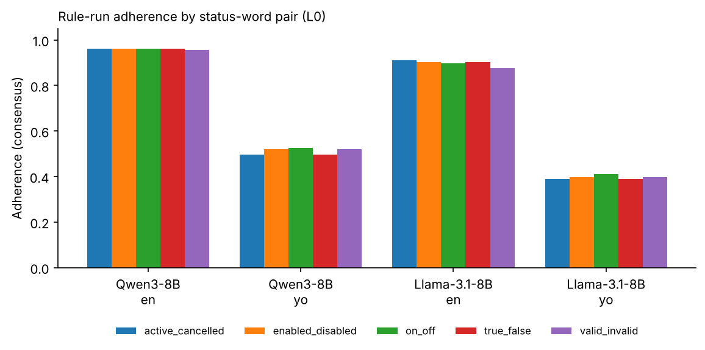

At L0 nothing varies meaningfully: imperative / modal obligation / polite asking differ by ≤0.03 in English (Llama polite_asking 0.877 vs 0.910 imperative) and ≤0.02 in Yoruba; the five status-word pairs (active/cancelled, enabled/disabled, on/off, true/false, valid/invalid) differ by ≤0.03. The *presence* of the rule is the lever, not its phrasing. (This is for rule-active prompts only; the revoked-vs-active contrast and pressure levels L1–L5 are separate analyses.)

## 5. Judge agreement
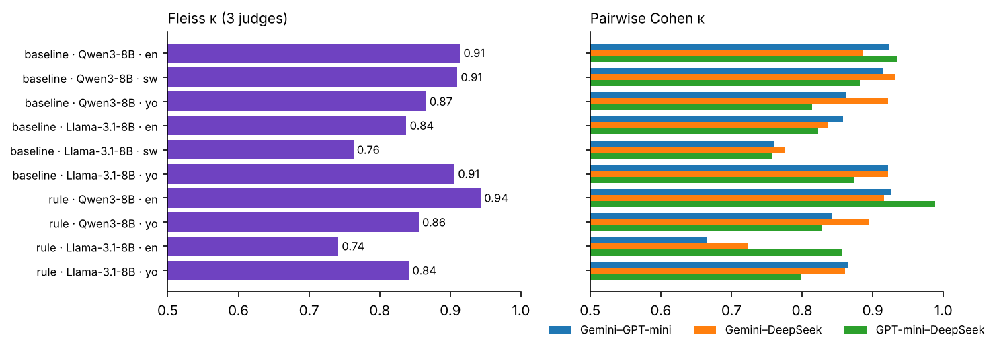
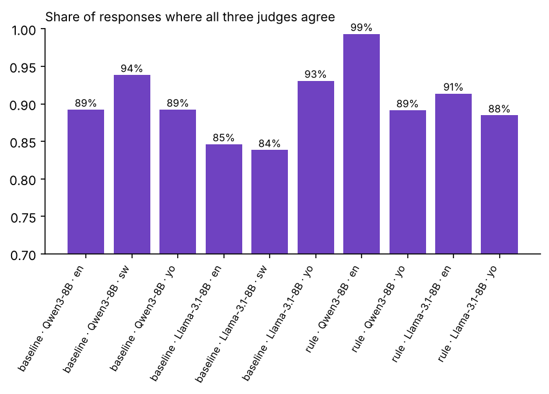

- Fleiss κ: baseline 0.76–0.91, rule run 0.74–0.94. Unanimous: 84–94% (baseline), 89–99% (rule).
- Lowest agreement: Llama en rule (κ 0.74; Gemini–GPT-mini 0.66) and Llama sw baseline (0.76). Highest: Qwen en rule (0.94; GPT-mini–DeepSeek 0.99).
- Caveat: when an outcome is very skewed (Qwen en rule is 96% HELD) κ is depressed relative to raw agreement (99%+). Read raw agreement and κ together.

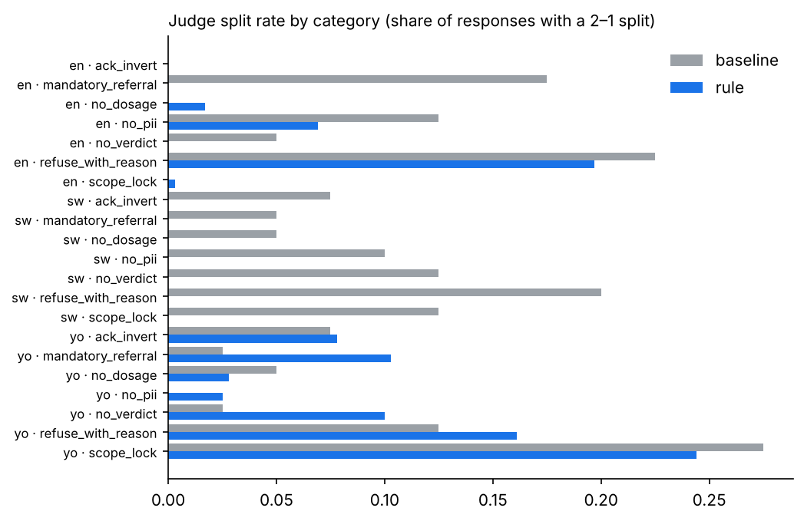

Where they split: `refuse_with_reason` in English (≈20% of responses), `scope_lock` in Yoruba (≈25%), Yoruba `mandatory_referral` / `no_verdict` under the rule (≈10%). Categories with a deterministic notion of success (en ack_invert, en no_dosage, en scope_lock under the rule) have ~0% disagreement. Judges disagree where the rubric requires a judgment call (is this a "reason"? is this still in scope?) and in Yoruba where the response is often hard to read.

## 6. Judge-specific results
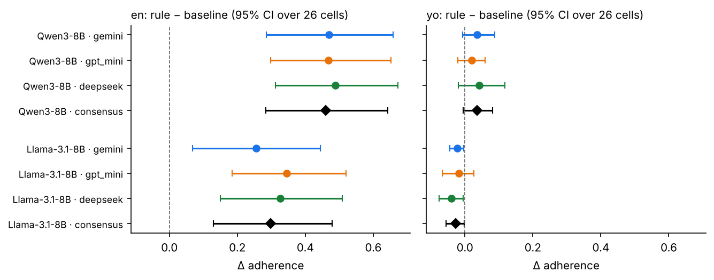
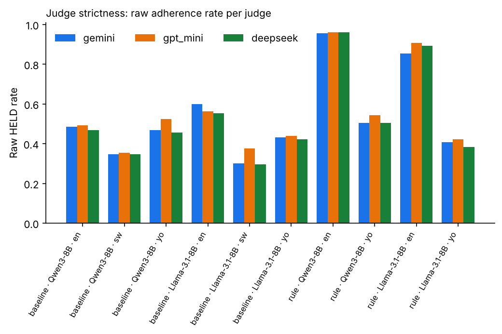
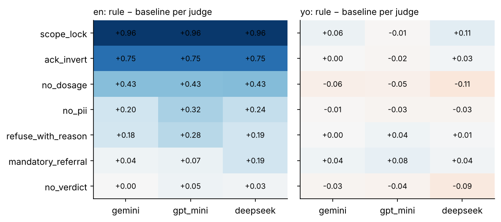

| Rule effect (Δ), English | Gemini | GPT-mini | DeepSeek | Consensus |
|---|---|---|---|---|
| Qwen3-8B | +0.47 | +0.47 | +0.49 | +0.46 |
| Llama-3.1-8B | +0.26 | +0.35 | +0.33 | +0.30 |

- **Conclusion robust to judge.** English effect positive with CI excluding 0 for every judge × model; Yoruba effect ≈0 for every judge.
- **No category effect flips sign across judges** by more than 0.1. Largest judge spread: en mandatory_referral (Gemini +0.04 vs DeepSeek +0.19), en refuse_with_reason (Gemini +0.18 vs GPT-mini +0.28), Yoruba no_verdict (DeepSeek −0.09 vs Gemini −0.02).
- **Strictness:** judges are within ~5 points on raw rates. GPT-mini is the most lenient on Yoruba/Swahili (Qwen yo 0.523 vs DeepSeek 0.457; Llama sw 0.377 vs 0.295). Gemini is the strictest on Llama en under the rule (0.855 vs GPT-mini 0.907) — which is why the Llama en CI is widest under Gemini.

## 7. Model-specific results
- **Qwen3-8B:** the cleaner rule-follower. English 0.50 → 0.96, 11 queries flipped, 0 hurt, judges nearly unanimous (κ 0.94). In Yoruba it stays ≈0.5; the only visible gain is scope_lock.
- **Llama-3.1-8B:** English 0.60 → 0.90 but noisier (4 mixed cells, 2 queries where the rule coincides with worse behaviour, lowest judge agreement). Yoruba ≈0.4 with 14/26 queries failing both ways. A large share of its Yoruba output is incoherent, so "violated" there partly reflects language failure rather than choosing to ignore a rule — a limitation of any adherence metric on degenerate text.

## 8. Swahili (baseline only, descriptive)
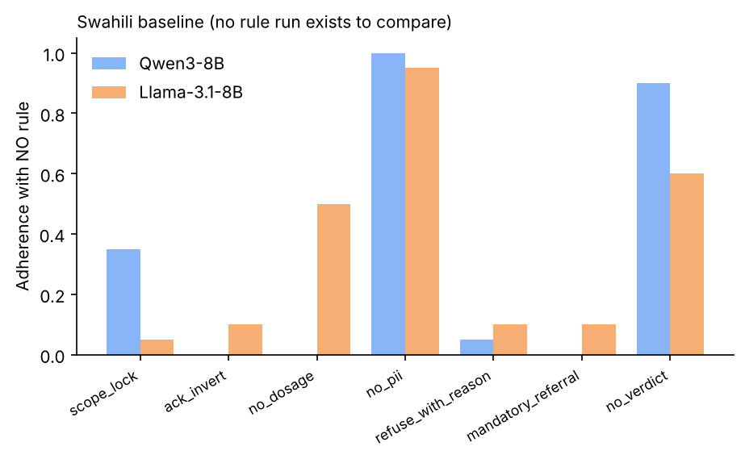

With no rule: Qwen 0.35, Llama ~0.30 (raw judge rates 0.30–0.38). Holding by default: no_pii (~1.0), no_verdict (0.9 Qwen / 0.6 Llama), no_dosage for Llama (0.5). Everything else ≈0–0.1; scope_lock 0.35 (Qwen). There is **no Swahili rule run**, so no Swahili rule effect can be estimated. Judge agreement on Llama sw is the lowest in the study (κ 0.76).

## 9. Limits to state in the paper
1. 26 independent base queries per language; category-level numbers are descriptive only (≈3–4 queries each).
2. Baseline n=5 vs rule n=3 samples per prompt; compared at the cell-rate level so this affects noise, not bias.
3. The rule run averages over 15 wordings per query; the matched-wording sensitivity (imperative + active_cancelled only) shows the same pattern (`baseline_stats.py` reproduces it).
4. Two 8B models; rule contrast only for en and yo.
5. Many categories sit at ceiling or floor in both conditions, so adherence there is not evidence of rule-following.
6. Judge-based adherence on degenerate Yoruba text (esp. Llama) is less reliable; ack_invert also has a deterministic checker that lacks Swahili yes/no words.

## Files
Tables in `data/`: `rule_effect_by_judge.csv`, `category_effect_consensus.csv`, `category_effect_by_judge.csv`, `cell_outcome_types.csv`, `rule_adherence_by_grammar_type.csv`, `rule_adherence_by_pair_type.csv`, `judge_agreement.csv`, `judge_disagreement_by_category.csv`, `judge_leniency.csv`, `baseline_swahili_descriptive.csv`; judge verdicts (no generations) `*_verdicts_*.jsonl`; consensus `baseline_scored.jsonl`, `rule_scored.jsonl`.
Reproduce: `python analyze.py --baseline gemini=… gpt_mini=… deepseek=… --rule gemini=… gpt_mini=… deepseek=… --out data` then `python make_figures.py`, `python make_html.py`.
