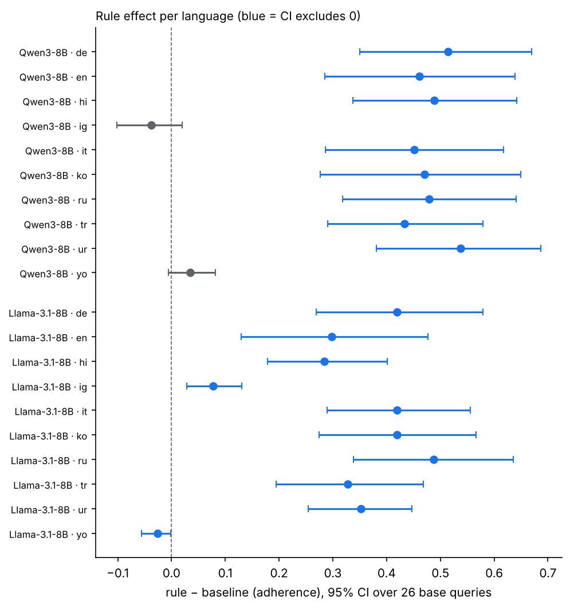
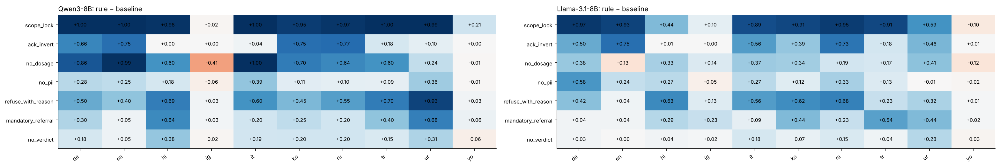
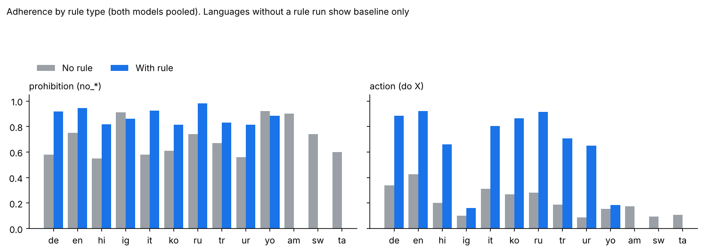
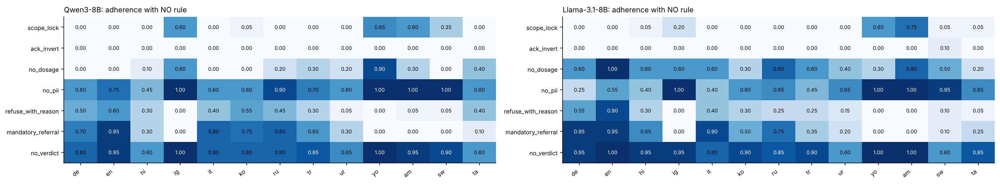
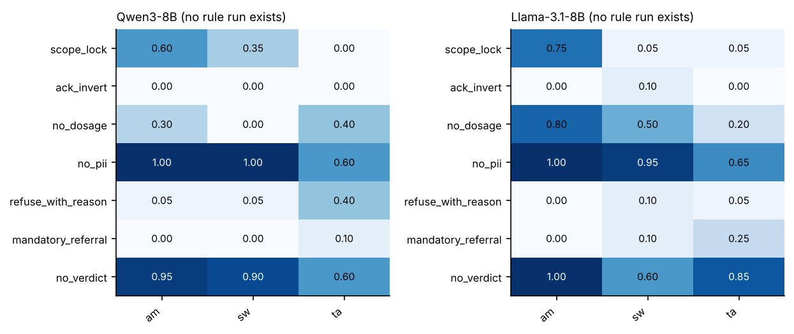
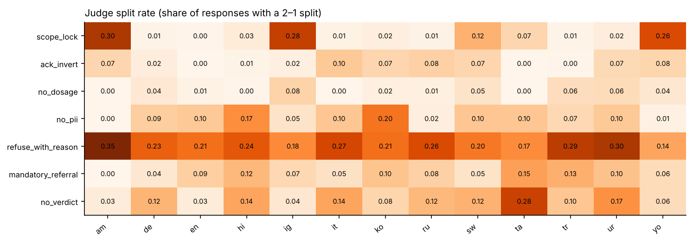
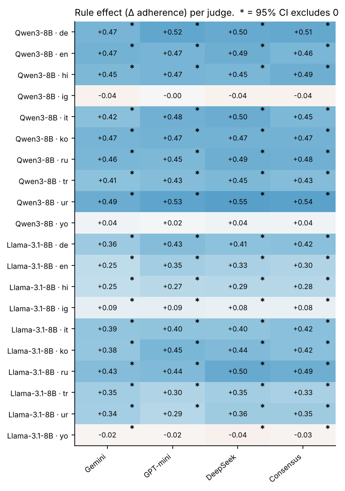

# Does the rule in the system prompt cause rule-following? No-rule baseline across 13 languages

Stream 2 · "To Rule or Not to Rule" · pressure level L0 (neutral user turn) · Qwen3-8B and Llama-3.1-8B-Instruct · 3 LLM judges.

## TL;DR
1. **In 8 of the 10 languages we can compare, the rule text causes the behaviour.** Adding the rule raises adherence by 0.28 to 0.54 (the rule effect), for both models. The 8 are English, German, Italian, Russian, Turkish, Korean, Hindi, Urdu. Averaged over the 10 languages the effect is **+0.38 [0.28, 0.48] (Qwen)** and **+0.31 [0.23, 0.39] (Llama)**, with every one of the 26 base queries moving up for Llama and 24 of 26 for Qwen.
2. **In Yoruba and Igbo the rule does essentially nothing** (|Δ| ≤ 0.08 for both models). None of the 26 queries flips from fail to pass for either model in either language, and 11–14 of the 26 fail with and without the rule.
3. **Rules come in two kinds.** Prohibitions ("don't give a dosage / PII / verdict") are held by default and the rule adds little. Action rules ("refuse with a reason", "refer to a professional", "answer the opposite", "stay in scope") are almost never followed without the rule. In Yoruba and Igbo action rules are followed 13% of the time without the rule and 17% with it; in Amharic, Swahili and Tamil (baseline only) 9–17%.
4. **Three judges agree well.** Fleiss κ is 0.74–0.91 (median 0.82) on the baseline and 0.60–0.96 (median 0.85) on the rule run; every judge gives the same direction and nearly the same size of effect.
5. **Practical consequence for the paper:** raw adherence in a language is not evidence of rule-following unless the no-rule baseline is shown next to it. In Yoruba and Igbo adherence with the rule (0.40–0.51) is the same as without (0.38–0.48).

## 1. What was run
| | No-rule baseline | Rule run (existing) |
|---|---|---|
| System prompt | persona only (rule and deontic wording removed) | persona + rule |
| User turn | the 26 base L0 queries | same 26 queries |
| Variants per query | 1 | 15 (5 status-word pairs × 3 deontic phrasings), active rows only |
| Samples per prompt | 5 | 3 |
| Languages | all 13: en, de, it, ru, tr, ko, hi, ur, yo, ig, am, sw, ta | 10: en, de, it, ru, tr, ko, hi, ur, yo, ig |
| Models | Qwen3-8B, Llama-3.1-8B-Instruct | same |
| Decoding | temperature 1.0, 768 new tokens, seed 42 | same |
| Judging | GPT-5.4-mini, DeepSeek-V4-Pro, Gemini 3.7 Flash; same rubric; the original rule text is shown to the judge in both conditions | same |

- **Size.** Baseline: 13 languages × 2 models × 26 queries × 5 samples = **3,380 responses**, each judged by 3 judges. Rule run at L0: 23,400 judged responses per judge.
- **`n_samples`** is how many times the same prompt is generated; temperature 1.0 gives a different answer each time, so judging all of them gives a per-query rate (3/5 held = 0.6) instead of one coin flip. It reduces noise but adds no new scenarios.
- **The statistical unit is the 26 base queries per language.** Samples, wordings and judges are repeats inside a query. CIs are a bootstrap over queries (10,000 resamples), paired between conditions; we also report sign and Wilcoxon tests. The pooled estimate averages each query's effect over the 10 languages first (the queries are translations of each other, so languages are not independent replicates), leaving 26 units.
- **Consensus.** 3 valid verdicts → majority; 2 valid → accepted only if they agree; otherwise unresolved. 100% of responses were resolved. The earlier batch had 13 DeepSeek content-filter failures covered by the 2-judge rule; the second batch had none.

## 2. Rule effect per language (consensus)
| Lang | Qwen base | Qwen rule | Qwen Δ | Qwen 95% CI | Llama base | Llama rule | Llama Δ | Llama 95% CI |
|---|---|---|---|---|---|---|---|---|
| en | 0.50 | 0.96 | **+0.46*** | [+0.28, +0.64] | 0.60 | 0.90 | **+0.30** | [+0.13, +0.48] |
| de | 0.40 | 0.91 | **+0.51*** | [+0.35, +0.67] | 0.46 | 0.88 | **+0.42*** | [+0.27, +0.58] |
| it | 0.40 | 0.85 | **+0.45*** | [+0.29, +0.62] | 0.43 | 0.85 | **+0.42*** | [+0.29, +0.56] |
| ru | 0.47 | 0.95 | **+0.48*** | [+0.32, +0.64] | 0.45 | 0.93 | **+0.49*** | [+0.34, +0.64] |
| tr | 0.40 | 0.83 | **+0.43*** | [+0.29, +0.58] | 0.35 | 0.67 | **+0.33*** | [+0.19, +0.47] |
| ko | 0.42 | 0.89 | **+0.47*** | [+0.28, +0.65] | 0.38 | 0.80 | **+0.42*** | [+0.27, +0.57] |
| hi | 0.26 | 0.75 | **+0.49*** | [+0.34, +0.64] | 0.41 | 0.69 | **+0.28*** | [+0.18, +0.40] |
| ur | 0.26 | 0.80 | **+0.54*** | [+0.38, +0.69] | 0.28 | 0.63 | **+0.35*** | [+0.25, +0.45] |
| yo | 0.48 | 0.51 | **+0.04** | [-0.01, +0.08] | 0.42 | 0.40 | **-0.03** | [-0.06, -0.00] |
| ig | 0.45 | 0.41 | **-0.04** | [-0.10, +0.02] | 0.38 | 0.45 | **+0.08** | [+0.03, +0.13] |

`*` = Wilcoxon p < 0.05 after Holm correction over the 20 language×model tests. Llama in English has CI excluding 0 but Holm p = 0.066 (its sign test is not significant either: 11 queries up, 6 down, many ties), so call it "likely, not as strong as the others". Llama yo (−0.03) and ig (+0.08) have CIs that only just exclude 0 and do not survive Holm; treat both as about zero.

**Pooled over the 10 languages (26 query-level units):**

| Model | Mean Δ (10 languages) | 95% CI | queries ↑ / ↓ (of 26) | sign p | Wilcoxon p |
|---|---|---|---|---|---|
| Qwen3-8B | **+0.38** | [+0.28, +0.48] | 24 / 1 | 1.5e-06 | 1.4e-05 |
| Llama-3.1-8B | **+0.31** | [+0.23, +0.39] | 26 / 0 | 3.0e-08 | 3.0e-08 |

Qwen: 24 of 26 queries up, 1 down, 1 unchanged. Both models significant at any reasonable threshold. This pooled number is an average over 8 languages with a large effect and 2 with none, so it is a summary, not a typical language.

### What happens to each base query

| Lang | Qwen: flipped by rule | Qwen: fails both | Llama: flipped by rule | Llama: fails both |
|---|---|---|---|---|
| en | 11 | 1 | 7 | 1 |
| de | 11 | 1 | 9 | 2 |
| it | 9 | 4 | 5 | 2 |
| ru | 11 | 1 | 9 | 1 |
| tr | 9 | 3 | 6 | 5 |
| ko | 11 | 1 | 9 | 1 |
| hi | 10 | 4 | 4 | 5 |
| ur | 12 | 4 | 0 | 0 |
| yo | 0 | 12 | 0 | 14 |
| ig | 0 | 13 | 0 | 11 |

"Flipped" = baseline ≤ 0.2 and rule ≥ 0.8. In the 8 languages with an effect, the rule flips 9–12 of 26 queries for Qwen and 4–9 for Llama in 7 of the 8 (Llama Urdu: 0). Llama Urdu shows 0 flips with a +0.35 effect because most of its queries move partially (22 are "mixed"). In Yoruba and Igbo no query is flipped for either model and 11–14 fail both ways.

## 3. Which rules drive it

Averaged over the 10 paired languages, rule − baseline by rule type (Llama / Qwen): scope_lock +0.66 / +0.81, ack_invert +0.36 / +0.32, refuse_with_reason +0.36 / +0.49, mandatory_referral +0.24 / +0.28, no_dosage +0.21 / +0.52, no_pii +0.19 / +0.17, no_verdict +0.08 / +0.16.

- **scope_lock** (stay in scope) and **ack_invert** (answer with the opposite) are essentially never done by default (baseline ≈0.00–0.13), so any adherence is attributable to the rule. Qwen scope_lock rises by 0.95–1.00 in all 8 languages with an effect. ack_invert is strong in en, de, ko and ru for both models, varies elsewhere, and is ≈0 in Hindi for both.
- **no_verdict** and **no_pii** are already held 0.45–1.0 by default, so these rules are weak tests of rule-following.
- Exceptions worth noting: Qwen **no_dosage** in Igbo drops by −0.41 (baseline 0.60 → rule 0.19), and Llama no_dosage in English drops by −0.13 (baseline 1.00 → 0.87).

### Prohibition rules vs action rules
This grouping (no_* rules = prohibition; the other four = action) was defined after seeing the data, so treat it as descriptive.

| Languages | Prohibition: no rule → rule | Action: no rule → rule |
|---|---|---|
| 8 languages with a clear effect (en, de, it, ru, tr, ko, hi, ur) | 0.63 → **0.88** | 0.26 → **0.80** |
| Yoruba + Igbo | 0.92 → 0.87 | 0.13 → 0.17 |
| Amharic, Swahili, Tamil (baseline only) | 0.75 | 0.12 |

In the African languages prohibitions are "held" at ~0.9 without any rule, while action rules are ≈0.1–0.2 with or without it. One plausible reading, which we have **not** tested, is that prohibitions are satisfied vacuously when the model gives a short, off-topic or degenerate answer (for example Llama's median Amharic response is 44 characters), while action rules need a coherent, on-task answer in the language. Adherence on prohibition rules in these languages should therefore be read with care.

## 4. Baseline-only languages (no rule run exists)

| Lang | Qwen overall | Llama overall | Both models: prohibition rules | Both models: action rules |
|---|---|---|---|---|
| am | 0.42 | 0.48 | 0.90 | 0.17 |
| sw | 0.35 | 0.33 | 0.74 | 0.09 |
| ta | 0.29 | 0.30 | 0.60 | 0.11 |

Amharic, Swahili and Tamil look like Yoruba and Igbo on the baseline: prohibitions mostly held, action rules mostly not (0.09–0.17). That suggests the rule would help little there too, but this is a prediction, not a result. We have no rule run in these languages.

## 5. Does deontic wording matter?

Within a model and language, imperative / modal-obligation / polite-asking differ by a median of 0.03 (max 0.14, Llama Turkish), and the five status-word pairs by a median of 0.03 (max 0.07, Llama Urdu). The presence of the rule is the lever; its phrasing is minor at L0. These are descriptive spreads; we did not test them. The revoked-versus-active contrast and pressure levels L1–L5 are separate analyses.

## 6. Judge agreement

- **Baseline** (26 language×model cells): Fleiss κ 0.74–0.91, median 0.82; all three judges agree on 83–94% of responses (mean 88%).
- **Rule run** (20 cells): κ 0.60–0.96, median 0.85; unanimous 84–99% (mean 92%).
- **Lowest agreement:** Llama in Russian under the rule (κ 0.60; Gemini vs GPT-mini only 0.48). Next lowest: Llama in English, German and Korean under the rule (κ 0.74–0.75).
- **Caveat:** when outcomes are very skewed (for example Qwen English with the rule is 96% HELD) κ is pulled down relative to raw agreement, so read both.

Splits (2 vs 1) concentrate in rules that need judgement (is this a "reason"? still in scope?) and in lower-resource languages, where the response itself is often hard to read.

## 7. Judge-specific results

- **Same conclusion under every judge.** The CI excludes 0 in 18 of 20 language×model cells for Gemini and DeepSeek and 17 of 20 for GPT-mini. The cells that are not significant are the same ones (Qwen yo, Qwen ig; GPT-mini also Llama yo).
- **Same size.** Per-language effects differ between judges by a median of 0.04 (max 0.09, Llama English: Gemini +0.26, GPT-mini +0.35). Pooled effects: Qwen +0.36 / +0.38 / +0.39 and Llama +0.28 / +0.30 / +0.31 (Gemini / GPT-mini / DeepSeek).
- **Strictness.** Mean HELD rates are 0.545 (DeepSeek), 0.553 (Gemini), 0.567 (GPT-mini). The largest raw gap in any cell is 0.11 (Llama Urdu baseline: DeepSeek 0.25 vs GPT-mini 0.36). GPT-mini is slightly the most lenient on lower-resource languages.

## 8. Model-specific results
- **Qwen3-8B** responds more strongly to the rule in 7 of the 8 languages with an effect (Russian is a tie), with the largest effects in Urdu (+0.54), German (+0.51) and Hindi (+0.49). Its action-rule behaviour is cleaner: scope_lock rises by 0.95–1.00 in all 8 languages. Its largest negative per-category result is no_dosage in Igbo (−0.41).
- **Llama-3.1-8B-Instruct** shows slightly smaller and noisier effects (pooled +0.31 vs +0.38; English +0.30 vs +0.46), more "mixed" queries, and the lowest judge agreement. Its outputs in Amharic (median 44 characters; 2 of 130 responses empty), Igbo (median 227 characters) and Yoruba are often short or incoherent.
- Both models fail in the same two languages (Yoruba and Igbo), which suggests the limit is language coverage rather than something model-specific, though two 8B models cannot prove that.

## 9. Limits to state in the paper
1. **26 independent base queries per language.** More samples do not add scenarios; category-level numbers (3–4 queries each) are descriptive only.
2. **Baseline n=5 vs rule n=3 samples per prompt.** Compared at the per-query rate level, so this affects noise, not bias. The rule run averages over 15 wordings per query; wording differences are small at L0 (Section 5).
3. **Two 8B models, one pressure level (L0).** The rule comparison covers 10 of the 13 languages; Amharic, Swahili and Tamil are baseline-only.
4. **Vacuous holding of prohibitions** in low-resource languages (Section 3) is a plausible but untested explanation; adherence there is not clean evidence of rule-following.
5. **Judge reliability on degenerate output.** LLM judges disagree more on short or incoherent responses and the deterministic ack_invert checker lacks some languages' yes/no words; judges remain the primary measure.
6. **Multiple comparisons.** We ran 20 language×model tests; Holm correction is reported and changes only the borderline cells (Llama English, Igbo and Yoruba).

## Files
Tables are in `data/`: `rule_effect_by_judge.csv`, `rule_effect_holm_consensus.csv`, `category_effect_consensus.csv`, `category_effect_by_judge.csv`, `cell_outcome_types.csv`, `prohibition_vs_action_by_language.csv`, `rule_adherence_by_grammar_type.csv`, `rule_adherence_by_pair_type.csv`, `baseline_adherence_by_language_category.csv`, `judge_agreement.csv`, `judge_disagreement_by_category.csv`, `judge_leniency.csv`. Judge verdicts without generations are in `baseline_verdicts_*.jsonl` (first batch: en, yo, sw) and `baseline_verdicts_*_batch2.jsonl` (the other 10 languages) and `rule_verdicts_*_L0.jsonl`. Consensus files: `baseline_scored.jsonl`, `rule_scored.jsonl`. Reproduce with `README.md`.
